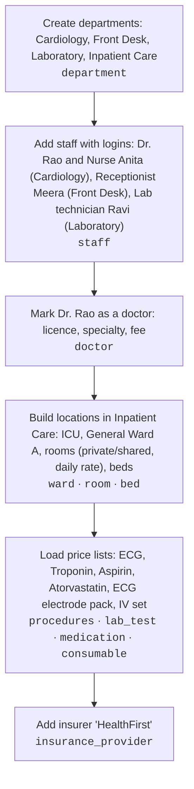

# User Journey — Peehu's Hospital Stay

One patient, **Peehu**, followed from booking to final payment. The journey is built so that every one of the 26 entities is written or read at least once. Entity names are in `code`; see `docs/entities.md` for what each one holds.

The hospital is assumed to be already set up (departments, staff, wards, price lists, insurers). What the journey relies on is described in [Prerequisite: hospital setup](#prerequisite-hospital-setup) at the end.

## Story

Peehu has chest pain. Peehu books a cardiology visit and arrives with an insurance card. The nurse takes Peehu's vitals, the doctor examines Peehu, orders a blood test and an ECG, and diagnoses a heart condition that needs observation. Peehu is admitted to an ICU bed, moves to a general ward bed on day 2, and is discharged with medication on day 3. The hospital bills Peehu, claims most of the amount from the insurer, and Peehu pays the rest.

## Diagram

```mermaid
flowchart TD
    subgraph S1["1. Registration and booking (Receptionist Meera)"]
        B1["Register Peehu, with emergency contact<br/><code>patient</code>"]
        B2["Record Peehu's policy, valid from / to<br/><code>insurance_policy</code>"]
        B3["Book cardiology visit with Dr. Rao<br/>type: outpatient, status: booked<br/><code>visit</code>"]
        B1 --> B2 --> B3
    end

    subgraph S2["2. Arrival and consultation (Nurse Anita, Dr. Rao, Lab technician Ravi)"]
        C1["Check in: status 'in progress', actual start set<br/><code>visit</code>"]
        C2["Take vitals: BP 150/95, pulse 104<br/><code>vital_sign</code>"]
        C3["Examine, record chief complaint and notes<br/><code>visit</code>"]
        C4["Order blood test 'Troponin'<br/><code>lab_order</code> → <code>lab_test</code>"]
        C5["Lab technician Ravi enters the result: elevated; order becomes 'completed'<br/><code>lab_result</code> · <code>lab_order</code>"]
        C6["Perform ECG<br/><code>procedure_history</code> → <code>procedures</code>"]
        C7["Nurse Anita records 1 pack of ECG electrodes used, tied to the ECG<br/><code>consumable_usage</code> → <code>consumable</code>"]
        C8["Diagnose 'Unstable angina' (primary)<br/><code>diagnosis</code>"]
        C1 --> C2 --> C3 --> C4 --> C5 --> C6 --> C7 --> C8
    end

    subgraph S3["3. Admission (Dr. Rao, Receptionist Meera, Nurse Anita)"]
        D1["Day 1: visit upgraded to type: inpatient<br/><code>visit</code>"]
        D2["Admit to ICU bed 1, end time blank<br/><code>bed_assignment</code> → <code>bed</code>"]
        D3["Repeat vitals every few hours<br/><code>vital_sign</code>"]
        D4["Nurse Anita records an IV set used at the bedside, tied to no procedure<br/><code>consumable_usage</code> → <code>consumable</code>"]
        D5["Day 2: transfer to General Ward A bed 3<br/>ICU stay gets an end time, new row opened<br/><code>bed_assignment</code>"]
        D1 --> D2 --> D3 --> D4 --> D5
    end

    subgraph S4["4. Treatment and discharge (Dr. Rao)"]
        E1["Prescribe Aspirin and Atorvastatin<br/>dose, frequency, duration, quantity to dispense<br/><code>prescription</code> → <code>medication</code>"]
        E2["Day 3, discharge: bed stay closed first, then status 'completed', actual end set<br/><code>bed_assignment</code> · <code>visit</code>"]
        E1 --> E2
    end

    subgraph S5["5. Billing and payment (Receptionist Meera)"]
        F1["Create invoice INV-2026-000001 for the completed visit, status 'draft'<br/><code>invoice</code>"]
        F2["Add lines: consultation, ECG, Troponin, bed days (ICU 1, General Ward A 2), medication, consumables<br/>prices copied from price lists, consultation fee and room rates; bed, lab and consumable lines linked to their source<br/><code>invoice_line</code>"]
        F3["Bill is final: status 'issued'<br/><code>invoice</code>"]
        F4["Meera types the claim amount (most of the total) and submits to HealthFirst under Peehu's policy<br/><code>insurance_claim</code>"]
        F5["Claim approved, then paid: status 'paid', approved and paid dates set<br/><code>insurance_claim</code>"]
        F6["Remaining balance = total − paid claim<br/>(derived, not stored)"]
        F7["Peehu pays the remaining balance by UPI, with the UPI reference<br/><code>payment</code>"]
        F8["Balance is zero: invoice status 'paid', set with the last payment<br/><code>invoice</code>"]
        F1 --> F2 --> F3 --> F4 --> F5 --> F6 --> F7 --> F8
    end

    B3 --> C1
    C8 --> D1
    D5 --> E1
    E2 --> F1
    F4 -. "claims against" .-> B2
    F5 -. "updates status" .-> F4
```

## Entity coverage

| # | Entity | Stage | What happens to it |
|---|---|---|---|
| 1 | `department` | Setup | Cardiology, Front Desk, Laboratory and Inpatient Care exist; staff, wards and the visit belong to them |
| 2 | `staff` | Setup | Dr. Rao, Nurse Anita (Cardiology), Meera (Front Desk) and lab technician Ravi (Laboratory) exist with roles and logins; Anita is `vital_sign.recorded_by` and `consumable_usage.recorded_by`; Ravi is `lab_result.resulted_by` |
| 3 | `doctor` | Setup | Dr. Rao's licence, specialty and consultation fee; Dr. Rao is the visit's doctor |
| 4 | `ward` | Setup | ICU and General Ward A, both in Inpatient Care |
| 5 | `room` | Setup | Rooms inside each ward, each private or shared with a daily rate; the ICU and General Ward A rooms set the bed-day charges |
| 6 | `bed` | Setup | ICU bed 1 and General Ward A bed 3 |
| 7 | `procedures` | Setup | ECG is in the price list |
| 8 | `medication` | Setup | Aspirin and Atorvastatin are in the drug list |
| 9 | `lab_test` | Setup | Troponin is in the lab price list |
| 10 | `consumable` | Setup | ECG electrode pack and IV set are in the supplies list, each with a unit price |
| 11 | `insurance_provider` | Setup | HealthFirst exists |
| 12 | `patient` | 1 | Peehu is registered |
| 13 | `insurance_policy` | 1 | Peehu's HealthFirst policy, with validity dates |
| 14 | `visit` | 1–4 | Booked, checked in, upgraded to inpatient on day 1, completed at discharge on day 3 |
| 15 | `vital_sign` | 2–3 | Taken at the clinic and repeatedly during the stay |
| 16 | `lab_order` | 2 | Troponin test (from `lab_test`) ordered by Dr. Rao |
| 17 | `lab_result` | 2 | The one result for that order, entered by lab technician Ravi; saving it sets the order to `completed` |
| 18 | `procedure_history` | 2 | ECG performed by Dr. Rao |
| 19 | `consumable_usage` | 2–3 | Two rows recorded by Anita: the ECG electrode pack (linked to the ECG `procedure_history` row) and an IV set in the ICU (no procedure link) |
| 20 | `diagnosis` | 2 | Unstable angina, marked primary |
| 21 | `bed_assignment` | 3–4 | Two rows: ICU (day 1 to 2), then General Ward A (day 2 to 3); the first ends at the transfer, the second at discharge |
| 22 | `prescription` | 4 | One row per drug, each with a quantity to dispense |
| 23 | `invoice` | 5 | One invoice for the completed visit; status goes draft → issued → paid |
| 24 | `invoice_line` | 5 | Consultation (price from `doctor.consultation_fee`), ECG, Troponin (linked to `lab_order`), two bed-day lines (linked to the two `bed_assignment` rows: ICU 1 day, General Ward A 2 days), medication lines (quantity from `prescription.quantity`) and two consumable lines (each linked to its `consumable_usage` row) |
| 25 | `insurance_claim` | 5 | Claim against Peehu's policy, amount typed by Meera; status goes submitted → approved → paid, with approved and paid dates |
| 26 | `payment` | 5 | Peehu pays the remaining balance (total minus the paid claim) by UPI, with the UPI reference |

## Notes

- **Happy path only, for now.** This journey is the normal flow: the claim is approved first time, the visit is never cancelled and there are no refunds. Exception flows (rejected claims and resubmissions, cancelled and no-show visits, emergency visits) are not designed yet.
- **Bed, lab and consumable charges are billed from their price sources.** Bed days use `room.daily_rate`, the Troponin test uses `lab_test.price` and each consumable uses `consumable.price`. Each becomes an `invoice_line` linked to its `bed_assignment`, `lab_order` or `consumable_usage`, so it cannot be billed twice or forgotten.
- **Bed days count calendar dates touched, minimum 1.** Peehu is in the ICU from day 1 and moves on day 2: the ICU stay bills day 1 only (the transfer date goes to the room moved into), and General Ward A bills days 2 and 3 (the discharge date counts). Three dates, three bed days.
- **Medication, procedure and consultation lines are typed by Meera.** Prices are copied from the price lists with no source link; the medication quantity comes from `prescription.quantity`.
- **The claim amount is Meera's figure.** The policy holds no coverage percentage, so she types the amount claimed (most of the total). On the happy path the insurer pays exactly that; Peehu's share is the total minus the paid claim.
- **Drugs given during the stay are not recorded.** The only prescription is written at discharge; medication actually administered in the ICU and ward is an open question (`docs/entities.md`), so it is neither recorded nor billed.
- **A consumable can be tied to a procedure or stand alone.** The electrode pack points at the ECG `procedure_history` row; the IV set is bedside use, so `procedure_history_id` is blank.
- **Bed occupancy is never stored.** ICU bed 1 becomes free when its `bed_assignment` row gets an end time.
- **Balance is derived.** What Peehu owes is the invoice total minus the insurer's share (the invoice's `insurance_claim` rows with status `paid`) minus Peehu's payments. The insurer's payout is never a `payment` row.
- **Admission changes the same visit.** Peehu's outpatient booking becomes an inpatient stay by changing `visit_type`, not by creating a second visit.
- **Steps follow the ordering rules** in `docs/entities.md`: discharge closes the bed stay before the visit is completed; the invoice is made only after that; the claim and the payment come only after the invoice is issued.

## Prerequisite: hospital setup

The journey above assumes the administration has already done this. It is a one-time job, repeated only when something new is added (a new doctor, ward, price or insurer).

What each setup record is used for in the journey:

| Setup record | Used in |
|---|---|
| Dr. Rao (`doctor`) | Stage 1: the visit's doctor. Stage 5: `consultation_fee` is the price of the consultation line |
| Beds (`bed`, `room`, `ward`) | Stage 3: bed assignments; room rates feed the bed-day invoice lines |
| `procedures`, `lab_test`, `medication`, `consumable` | Stages 2, 4, 5: what can be ordered, prescribed or used, and the price source for invoice lines |
| HealthFirst (`insurance_provider`) | Stage 1: the insurer of Peehu's policy |
